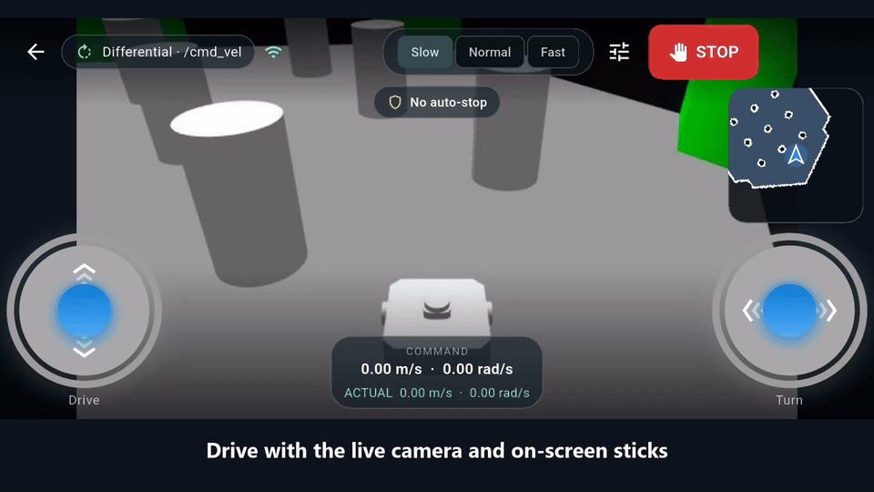

# Mobile ROS

The ROS 2 app for your phone and tablet (Android). It connects however your robot is set up, lets you tell
the robot what to do in plain words, and keeps the tools you reach for while testing.



*Driving with the live camera, then a plain-language command checked step by step and carried out (TurtleBot3 + Nav2 in Gazebo).
Full one-minute demo: https://youtu.be/iMq66I9VfAg*

**Get it on Google Play:** https://play.google.com/store/apps/details?id=com.hoyadong.ros_tester

> Open source under the Apache License 2.0. The optional remote-access service (relay, accounts) runs at
> mobile-ros.com and is not part of this repository; everything on-site works without it.

## Connect

Pick the way your robot already runs. Nothing else is needed on the robot.

| Mode | On the robot | In the app |
| --- | --- | --- |
| rosbridge (ROS 1 & 2) | `ros2 launch rosbridge_server rosbridge_websocket_launch.xml` | robot address, port 9090 |
| Foxglove bridge | `ros2 launch foxglove_bridge foxglove_bridge_launch.xml` | robot address, port 8765 |
| Direct ROS 2 (DDS) | nothing (same Wi-Fi, same `ROS_DOMAIN_ID`) | domain ID |
| Zenoh | `RMW_IMPLEMENTATION=rmw_zenoh_cpp` and a Zenoh router | router address, domain ID |

Drive commands need something on the robot that stops the base when commands stop arriving (a driver timeout,
`twist_mux`, or `robot_side/cmd_vel_watchdog.py` from this repository). The app checks and tells you.

## What it does

- **Drive**: live camera, on-screen sticks, keyboard (WASD / arrows) or a gamepad; STOP always on screen.
- **Map and navigate**: make a map, tap to send the robot (Nav2), saved places and floors, 3D map.
- **Assistant**: "go forward 1 m, turn left, then go to the kitchen". An on-device model works offline; an online
  model handles harder requests. Every step is checked against the robot's limits before anything moves.
- **Fleet**: a few robots in namespaces (`/robot1`, `/robot2`, …) on one screen, one assistant, STOP all.
- **Debug**: ROS explorer, publish messages, call services, tune parameters, robot log, message graphs.
- **Topic health**: rate now vs usual, time since the last message, and what looks wrong: a topic that stopped,
  a lidar or IMU whose values froze while messages keep coming, timestamps that repeat or run backwards.
- **Robot diagnostics**: `/diagnostics` or `/diagnostics_agg` worst first with details; a part that turns to
  ERROR is a notification and goes into the incident record.
- **Incident record**: the last 5 minutes (path, commands, trips, errors) saved when something goes wrong;
  export as MCAP to replay in Foxglove.
- **Alerts**: low battery, stuck on the way, link lost while moving.

## Robot-side scripts

| File | What it is |
| --- | --- |
| `robot_side/cmd_vel_watchdog.py` | Stops the base when velocity commands stop arriving |
| `robot_side/mobile_ros_agent.py`, `install_agent.sh`, `register_robot.py` | Robot side of the optional remote access |

## Online assistant on your own key

The app's online assistant talks to a small proxy that holds the model key, so the key never sits in the app.
Run it yourself with your own key:

```sh
python tool/agent_proxy.py --provider gemini --key-file ~/gemini-key.txt --host 0.0.0.0 --port 8787 --token <shared-secret>
```

Then in the app: Assistant → Settings → online, `http://<pc>:8787/v1/plan` and the same token.

## Build from source

Flutter (stable, 3.38+). Native parts (direct DDS, Zenoh) build with the Android NDK through CMake.

```sh
flutter pub get
flutter analyze lib test tool
flutter test
flutter run
```

Live end-to-end tests run against a TurtleBot3 + Nav2 simulation in a ROS 2 WSL distro on Windows
(`scripts/dev-env/`): `bash scripts/dev-env/sim_live_test.sh` (see the header of that script).

## Remote access is optional

Everything above works on site with no account and no cloud: the four connections, driving, maps, the assistant
(on-device model, or the online model through your own proxy), fleets and the debugging tools.

Remote access (reaching a robot from another network) is an optional service at mobile-ros.com:

- The robot runs `robot_side/mobile_ros_agent.py` (in this repository), which opens one outgoing TLS connection to the
  relay. Nothing on the robot listens to the internet.
- The relay forwards rosbridge messages between the app and the robot. It **does not store message contents**
  (camera, maps, commands). It keeps your account, your robot registrations, usage counts, and a short security log
  per session: when it started and ended, and the names of the topics and services used.
- Safety does not depend on the relay: the app checks every assistant step before anything moves, and the robot side
  stops the base when commands stop arriving. The relay additionally blocks driving for people you shared a robot
  with as "view only".

## Contributing

Issues and pull requests are welcome; see [CONTRIBUTING.md](CONTRIBUTING.md).

## Report a problem

Open an issue with: the connection mode, ROS distro, robot (or simulation), what you did and what happened.
In the app, **Incident records → Copy** gives a JSON record of the last minutes that helps a lot
(or **Export as MCAP** and attach the file).

## Privacy

Instructions and camera pictures go to the online model only when you use it; privacy mode keeps everything
on the phone. Maps, places and incident records stay on your phone.

## License

Apache License 2.0 — see [LICENSE](LICENSE). The app also contains llama.cpp (MIT), Eclipse Cyclone DDS (EPL-2.0 / EDL-1.0)
and Eclipse zenoh-pico (EPL-2.0 / Apache-2.0): see [THIRD_PARTY_NOTICES.md](THIRD_PARTY_NOTICES.md). "Mobile ROS" and its logo are the project's names; forks should use their own.
