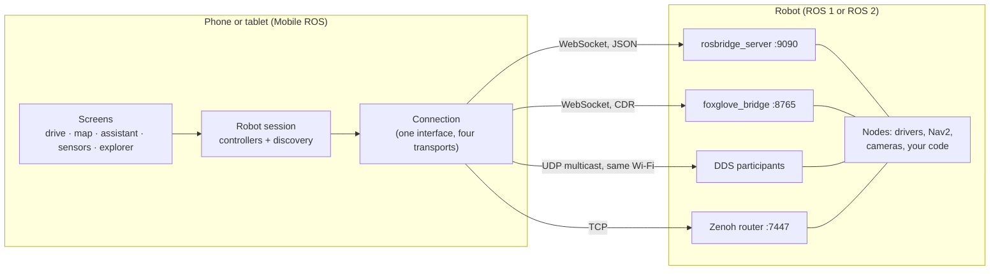
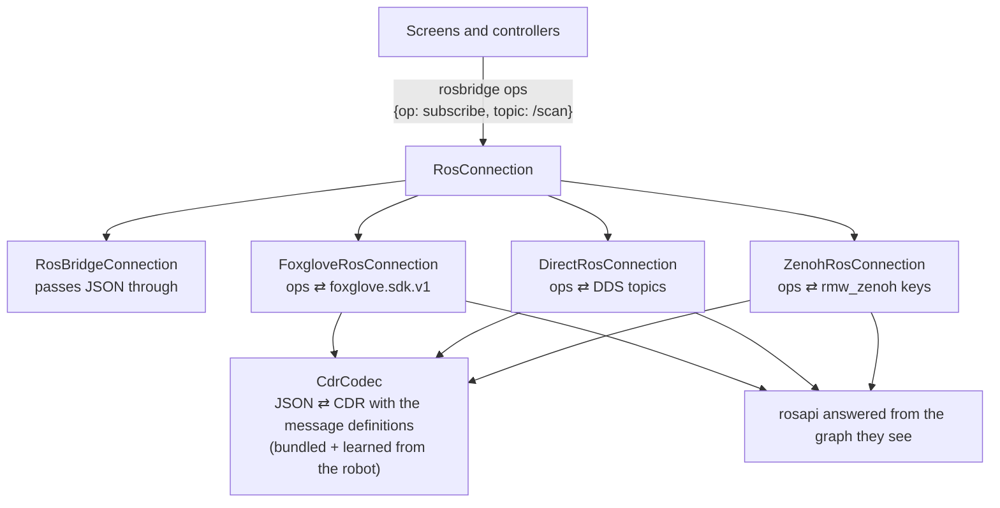
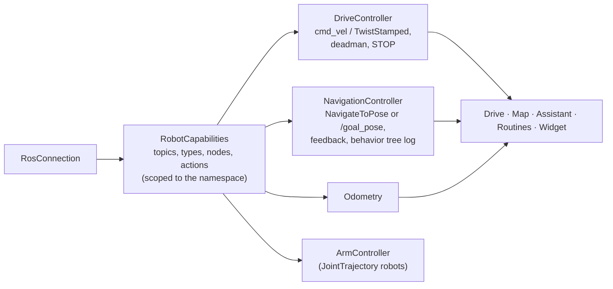
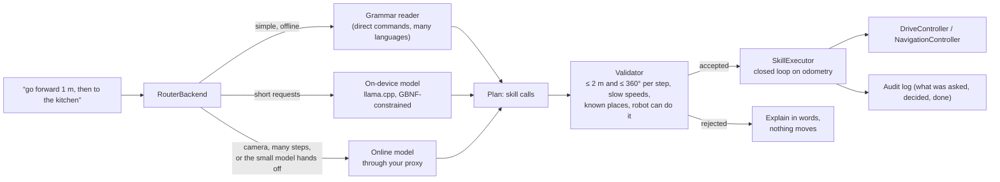
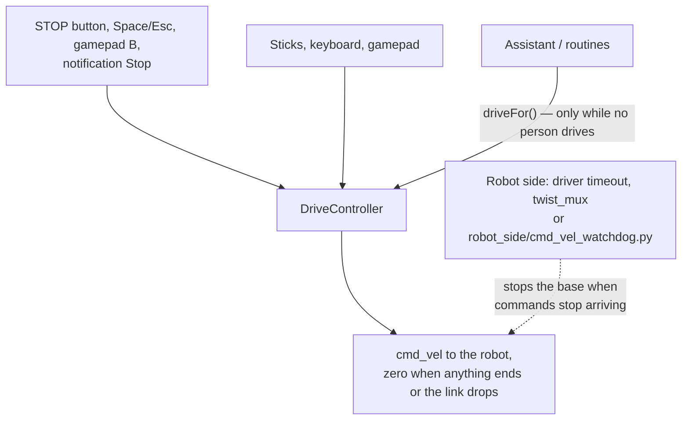
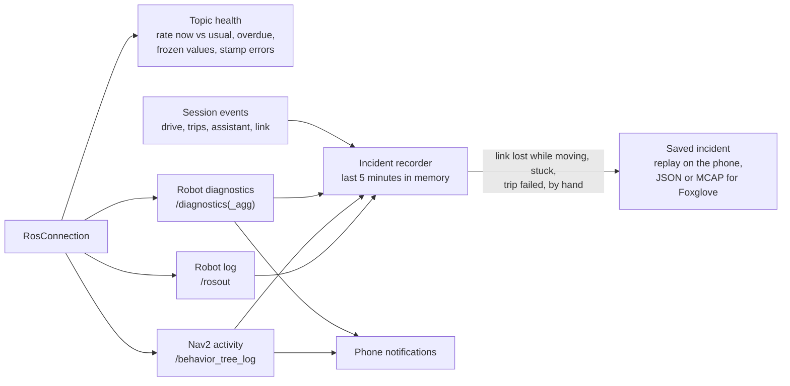
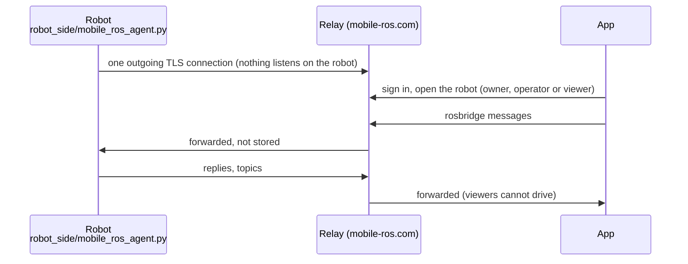

# Architecture

How Mobile ROS is put together, for people who want to change it. The diagrams are [Mermaid](https://mermaid.js.org)
and render on GitHub; edit them as text.

- [The big picture](#the-big-picture)
- [One protocol inside the app](#one-protocol-inside-the-app)
- [A robot session](#a-robot-session)
- [The assistant: plan, check, then move](#the-assistant-plan-check-then-move)
- [Who may move the robot](#who-may-move-the-robot)
- [Watching the robot](#watching-the-robot)
- [Remote access (optional)](#remote-access-optional)
- [Where things are](#where-things-are)

## The big picture

The app is a Flutter app (Android first; the same code runs in a browser and on Windows for development). It talks to
the robot over whatever the robot already runs. Nothing app-specific has to be installed on the robot.

| Transport | Robot side | App side | Platforms |
| --- | --- | --- | --- |
| rosbridge (ROS 1 & 2) | `rosbridge_server` | `lib/ros_connection.dart` | all |
| Foxglove bridge | `foxglove_bridge` | `lib/foxglove_connection.dart` | all |
| Direct ROS 2 (DDS) | nothing | `lib/dds/` + `native/dds` (Cyclone DDS) | Android |
| Zenoh | `rmw_zenoh_cpp` + router | `lib/zenoh/` + `native/zenoh` (zenoh-pico) | Android, Windows |

## One protocol inside the app

Every transport is a `RosConnection` (`lib/ros_connection.dart`) that speaks the **rosbridge v2 operations**
(`subscribe`, `publish`, `call_service`, `send_action_goal`, …) and answers the `/rosapi/*` services. The rosbridge
connection passes them through; the other three translate. Screens and controllers never know which transport is in
use, so a feature written once works on all four.

`RosClient` (`lib/ros_client.dart`) sits on top with typed helpers: subscriptions with their own ids, publishers,
service calls and actions with feedback.

## A robot session

`RobotSession` (`lib/robot_session.dart`) is one robot on one connection. It lives as long as the workspace, not a
screen, so the assistant can drive while any screen is open. Several sessions share a connection when robots run in
namespaces (`/robot1`, `/robot2`): that is the fleet view.

Discovery picks topics by type first and conventional name second (`lib/topic_discovery.dart`), so a robot that
publishes `/wheel/odometry` instead of `/odom` still works; people can override every choice per robot.

## The assistant: plan, check, then move

A language model never touches the robot. It proposes **skill calls** (`move`, `rotate`, `navigate_to`, `look`, …);
the validator checks each one against the robot's limits and what it can do; only accepted calls reach the
controllers.

- `lib/agent/router_backend.dart` decides which model answers. `lib/agent/instruction_language.dart` reads direct
  commands without any model.
- `lib/agent/local/` is the on-device model (`native/llm`, llama.cpp). The model file is downloaded by the app on
  first use; the web build has no on-device model.
- `lib/agent/cloud_backend.dart` talks to an online model only through a proxy you run
  (`tool/agent_proxy.py`); the app holds no API key.
- `lib/agent/validator.dart` and `lib/agent/executor.dart` are the safety boundary. Change them with live tests.

## Who may move the robot

One rule everywhere: **STOP beats the person, the person beats the assistant.**

The app checks whether the robot has its own stop-on-silence and says so; it is not safety-certified, so the robot
must not depend on the phone to stop.

## Watching the robot

Tools for "why did it stop?" while standing next to it:

## Remote access (optional)

Everything above works on site without an account. Reaching a robot from another network goes through the relay at
mobile-ros.com, a separate, closed service; the parts in this repository are the app side and the robot agent.

## Where things are

| Path | What |
| --- | --- |
| `lib/main.dart`, `lib/connect_page.dart`, `lib/main_page.dart` | App start, connecting, the robot workspace |
| `lib/ros_connection.dart`, `lib/ros_client.dart` | The connection interface and rosbridge; typed client |
| `lib/foxglove_connection.dart`, `lib/dds/`, `lib/zenoh/` | The other three transports and the CDR codec |
| `lib/robot_session.dart`, `lib/robot_capabilities.dart`, `lib/controllers/` | Sessions, discovery, drive/navigation/arm |
| `lib/agent/` | The assistant: routing, models, validator, executor, fleet |
| `lib/*_page.dart` | Screens |
| `lib/l10n/` | Strings in five languages (`app_en.arb` is the source) |
| `native/` | C sources and build scripts for DDS, Zenoh and llama.cpp; prebuilt libraries are committed |
| `robot_side/` | Scripts that run on the robot: cmd_vel watchdog, remote agent |
| `scripts/` | Simulated robots (WSL + Gazebo + Nav2), a fake rosbridge robot, dev-environment setup |
| `test/` | Unit and widget tests (`flutter test`) |
| `tool/live_*.dart` | Live tests against a real or simulated robot |
